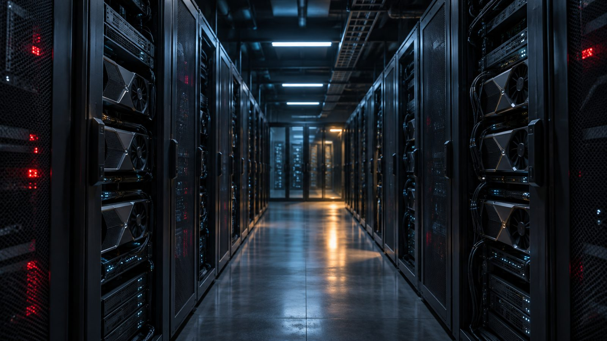

美股白天跌完，亚洲接着跌，等到美国再开盘，又是一轮。美东时间 11 月 20 日，纳斯达克综合指数单日下跌 5.3%，一周累计下跌 10%。标普 500 单日下跌 3.7%，较 10 月高点回撤超过 10%。费城半导体指数当天下跌约 11%，英伟达跌约 14%。这样的跌幅足以重新审视 AI 交易，但要判断是不是走到了 2000 年，得先看市场究竟在担心什么。

6 月韩国熔断那天，我写过[《AI 泡沫的第一道裂缝？》](/2026-06-26/ai-bubble-first-crack.html)，问的是：市场看重的是故事，还是利润？五个月后，英伟达交出了营收翻倍的财报，股价照样大跌。利润已经摆在桌上，市场怀疑的是它能持续多久。

<!--more-->

### 财报翻倍，为什么还是先涨后跌？

英伟达 11 月 17 日披露，截至 10 月 25 日的季度营收为 1,158 亿美元，同比增长 103%，其中数据中心营收 1,076 亿美元，同比增长 110%。财报在 17 日美股收盘后发布，18 日英伟达收跌 2.9%；19 日盘中一度涨 4.7%，收盘又跌了约 3.3%。同一天，Anthropic 以 111.50 美元开盘，较 83 美元的发行价高出 34%，收盘回落到 97.17 美元，纳指当天跌了 2.3%。次日 Anthropic 再跌 8.5%，收于 88.91 美元，盘中最低 83.05 美元，几乎回到发行价。

周五的下跌还有一个时间点很清楚的催化剂。《华尔街日报》17 日已报道美国证交会在调查英伟达，当时焦点不明；周五路透援引两名知情人士称，调查关注的是会计处理。报道发出前，英伟达已跌逾 6%；报道发出后，跌幅扩大至约 13%，收盘约跌 14%。报道当时，监管机构拒绝置评，具体审查事项仍不明确。至于整周抛售，路透此前已指出，市场同时在担心通胀、利率和数据中心建设前景。

11 月 12 日，黄仁勋辞去 CEO，CFO 科莱特·克雷斯出任临时 CEO。英伟达的公告没有说明辞职原因。高管更替和 SEC 调查给英伟达增加了自身的不确定性。与此同时，亚洲芯片股在周五美股开盘前已经下挫，CoreWeave 的债券收益率也早在 11 月 6 日就突破了 16%。这轮抛售还有更早出现的融资压力，以及更广泛的行业下跌。

芯片卖得好，是上一季度的收入。股价还要给接下来几年定价。芯片商看的是订单，买芯片、建数据中心的公司看的是这些投入最终能赚回多少钱。客户越积极采购，芯片商的业绩越好看，客户自己要达到的回报门槛也越高。

9 月我在[《高景气不是“增速高”，是“增速在变快”》](/2026-09-14/prosperity-is-delta-not-level.html)里记过一句：股价是结果，盈利预期的修正方向才是信号。103% 是水位，市场这周定价的是水位之后的方向。路透 18 日援引 LSEG 数据称，财报发布后，分析师对英伟达下一财年调整后净利润的平均预期从 3,800 亿美元升至 3,930 亿美元，平均目标价却从周一的 265.70 美元降至 251.74 美元。盈利预期在上修，分析师给出的平均目标价却在下调。我更关心的是，买算力的公司能赚回多少。

### 和 2000 年最像的地方，是基础设施先投了下去

S&P Global 在 2025 年 12 月的复盘中指出，从 2000 年 3 月见顶到 2002 年 10 月见底，纳斯达克综指累计下跌近 80%。该机构认为，新一轮上涨涉及的许多大型科技公司已有成熟业务和盈利，传统估值指标整体也没有当年那么极端。这让两轮行情的起点有别。即便如此，互联网最终改造了经济，当时买入过高估值或建得太早的投资者仍然可能亏钱。

相似之处在投资规模。IMF 今年 10 月估算，2025 年超大规模云服务商的资本开支约为 5,000 亿美元。按 IMF 使用的口径，美国科技投资占 GDP 的比重也已越过互联网泡沫时期的水平。报告还提到，随着投入继续扩大，融资开始从企业自有现金流延伸到外部融资及更复杂的安排。即使行业需求继续增长，只要新增产能投得比客户付费快，回报就会承压，融资更依赖外部市场的公司尤其敏感。

所以，“估值还没疯到 2000 年那样”和“这轮已经跌得很重”可以同时成立。成熟公司的盈利给估值提供了支撑，集中在同一条产业链上的预期也会一起下修。IMF 在 10 月《全球金融稳定报告》中专门提示，AI 投资回报低于预期时，集中持仓和杠杆可能放大价格调整。

10 月在[《从终产者到挪威：AI 时代的三种结局》](/2026-10-09/ai-three-endings.html)里，我把这轮投资的出口分成三条：收入追上来、融资链先断、政策托底，并且倾向于第二条，断裂多半从中间层开始，也就是靠借债扩张的新兴云厂商、用未来合同抵押的数据中心项目，以及收入依赖少数大模型公司的供应商。这周的焦点还是芯片龙头的估值和会计疑云，但中间层已经在发热。11 月 6 日，CoreWeave 一只 2032 年到期、票息 9.625% 的债券，二级市场收益率超过 16%。管理层在三季度电话会上表示，按现在的利率不会再去无担保债市场融资，转而让客户预付、按具体合同抵押借款。这还不是断裂，但压力出现的位置，和 10 月预想的一样。

### 为什么看起来亚洲和美国在互相带跌？

11 月 20 日亚洲收盘时，韩国 KOSPI 跌约 5.2%，日经 225 跌约 4.8%，台湾加权指数跌约 6.6%。这些跌幅发生在美国周五开盘之前。亚洲先消化美国周四行情，再给当地的芯片、存储和设备公司定价。等到美国开盘，美国市场又消化同一条供应链的变化以及本土新消息。只要全球资金同时下调对 AI 资本开支的预期，同一笔交易就能在不同时区被反复重估。

这也解释了为什么周五美股大跌会给亚洲下一次开盘增加压力，却不能直接套用跌幅。韩国、日本和台湾部分权重股与全球半导体周期联系紧密。放到国内市场，港股科技股、A 股算力和半导体板块若同步走弱，海外冲击才更可能往宽基传。判断中证 500 和中证 1000 的强弱，要看相关板块对各自指数的跌幅贡献，以及下跌有没有扩散到更多成分股，不能拿隔夜纳指的跌幅直接换算。

### 什么情况下，我会把判断改成泡沫破裂？

1. **采购有没有真的砍下去。** 如果多家云厂商连续下调资本开支指引，芯片、服务器和机房订单也同步走弱，就有了供需拐点的证据。
2. **收入能不能跑赢成本。** 如果 AI 业务收入仍在增长，新增折旧和运营成本却持续吃掉利润，资本开支越大，重新估值的压力可能越重。这是“收入追上来”那条出口能不能走通的检验。
3. **融资有没有开始卡住。** 如果数据中心项目越来越难以续融，推迟或取消开始集中出现，风险就可能从股票估值传到实际投资。这对应的是“融资链先断”。

出现一条，可能只是某家公司或某个季度的问题。如果压力扩散到多家云厂商，并开始影响订单或续融，我会改判断。

所以我的回答是：还没到 2000 年。像的是钱先投了下去，压力也先出现在借钱扩张的中间层；不像的是，个别公司出现了交付和融资压力，但还没看到集中砍单或续融受阻。截至周五收盘，我仍倾向于把这轮看作一次幅度很深的估值和风险偏好调整。市场正在收回原先给 AI 盈利前景的乐观定价。2000 年提供的参照是，技术扩散可以和投资回报恶化同时发生。6 月问的是押故事还是押利润，这一次利润有了，要回答的是下一轮财报里，买算力的公司还愿意花多少钱，以及它们已经花出去的钱能收回多少。
